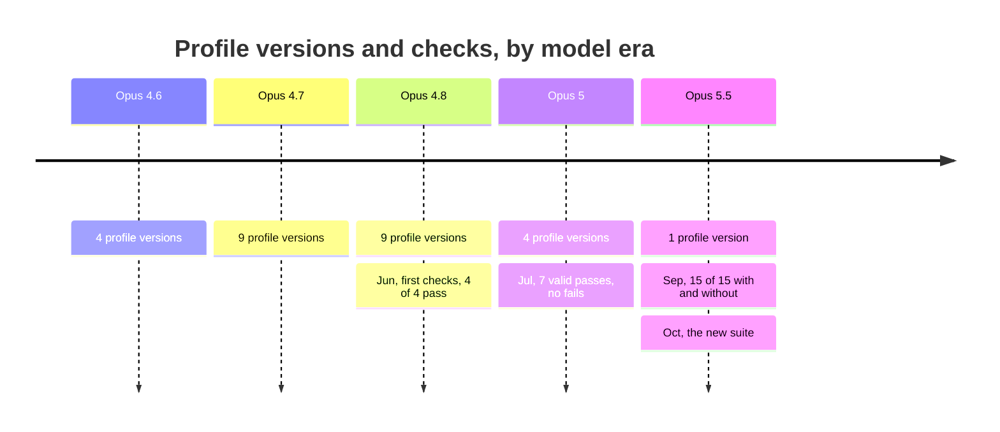

# A personal verification kit for LLM-assisted work

**Working notes, not a framework.** I'm not a prompt engineer — I'm an
engineer who uses LLMs for research, analysis, and decisions, and who got
tired of plausible-but-ungrounded answers. Starting in March 2026 I
iterated on my personal assistant configuration and, along the way, built
a small set of instruments that turned out to be the durable part. This
package shares those. It's one person's method, graded by one person's
judgment. Take what's useful, discard the rest.

## What's here

- **[Failure-pattern taxonomy](failure-pattern-taxonomy.md).** Recurring ways
  LLM answers go wrong, each with a binary FAIL test. Every pattern came from a
  failure in my own chat transcripts rather than from an attempt to enumerate
  the space.
- **[Trace self-audit template](trace-self-audit-template.md).** A static,
  domain-neutral prompt that grades a supplied conversation against the
  taxonomy, requires a quote for each finding, forbids manufacturing them, and
  routes each finding to an account-level rule, a project-level prompt, or a
  watch item.
- **[Regression corpus method](regression-corpus-method.md).** How a confirmed
  failure becomes a private regression entry, including the run protocol and
  grading conventions. The entries stay private; this repository contains the
  method.
- **[Evolution and lessons](evolution-and-lessons.md).** A dated account of
  what changed, what failed, and which apparent improvements were later
  withdrawn or narrowed.

## How I use the regression loop

Grading is manual: start a fresh chat, provide the trigger, and judge the result
against the binary check. There is no automation or CI. A pass over the corpus
is a handful of fresh chats and a Markdown table; the
[corpus method](regression-corpus-method.md) owns the details.

The corpus has a handful of private entries. Its purpose is a no-regression
gate for this workflow, not a benchmark or a claim that the instructions caused
an outcome.

## What the runs showed

- The first baseline ran 2026-06-10: two entries across two current models,
  fresh chats, and 4/4 passes after the config fix the original failures
  motivated. The same run showed that a planned config rewrite was unnecessary,
  so I dropped it unshipped.
- A second batch ran 2026-07-26 against a newly released flagship model: eight
  entry-model runs, **seven valid passes, no failures**, including the first
  real validation of the P13 and P14 fixes and confirmation of three
  provisional entries.
- The remaining run was discarded because it reused the origin trace's phrasing
  and tested recall rather than the fix. That entry remains open.
- The first control arm ran 2026-09-25: the same checks with my profile off.
  15 of 15 runs passed either way, so those checks couldn't tell.
- In October a private suite of cases that had drawn a FAIL without the
  profile did separate the setups: where both model judges agreed, 39 of 105
  runs failed without the profile and 18 of 114 with it. The evolution notes'
  October 12 entry has the limits.

Most of the profile's rewriting came before the checks could tell a
difference:

Share of runs that failed, where both judges agreed (October suite):

| Setup | Failed | Runs where both judges agreed |
| --- | --- | --- |
| Platform prompt only | 37% | 39 of 105 |
| Profile minus the first rule the case lists | 22% | 25 of 113 |
| Full profile | 16% | 18 of 114 |

The price was answers about 75% longer and runs about 70% slower (medians).

Then I labelled 20 runs the judges had agreed on, five per box, without
seeing their verdict. The profile's footer showed me the setup every time.

| | Judges said PASS | Judges said FAIL |
| --- | --- | --- |
| **With profile** | I passed 3; 2 I couldn't decide | I passed 4; 1 I couldn't decide |
| **Without profile** | I failed 4; 1 I couldn't decide | I passed 2, failed 2; 1 I couldn't decide |

The judges graded whether one rule was followed; going by my reasons, I
graded the whole answer.

The limits matter: the June and July runs had no config-off control arm
(control arms ran later, in September and October; see the evolution notes),
so their green results are a no-regression gate and not proof that the
instructions caused the passes; one
entry was graded from a partial read of the response; and several patterns
still have no regression entry. The useful result is not the score. The loop
changed a decision and caught itself grading a result that did not count.

## Try it on one conversation

1. Take a recent substantive LLM conversation — research, a comparison,
   a recommendation you acted on.
2. Paste the [self-audit template](trace-self-audit-template.md#paste-ready-template-copy-everything-in-the-block)
   at the end (or, better, into a fresh chat with the transcript attached — a
   model grades its own thread more gently than a clean session does). Use a
   surface that transcript is allowed to reach.
3. Read the findings. If one stings, write the one-line rule that would
   have prevented it, and put it where the routing says it belongs.

## Caveats, upfront

- **n = 1.** Patterns and fixes come from my usage profile; yours will
  surface different failures.
- **Subjective grading.** Binary checks reduce but don't remove judgment;
  I am the only grader so far.
- **Drift.** Model-version-specific observations age in months. The
  taxonomy and the loop age well; any per-model claims should be
  re-verified before you rely on them.
- **Not included, by choice:** my actual configuration text (tuned to my
  register and defaults — wrong for you by design); the corpus *entries*
  themselves (distilled from personal transcripts; the method is in
  `regression-corpus-method.md`); and the one-time, venue-specific
  internal-socialization prompt for deciding where to post this (it names
  internal tooling, so it stays out).

Adapt freely. If you build your own corpus, I'd genuinely like to see
which patterns your usage surfaces that mine didn't.
